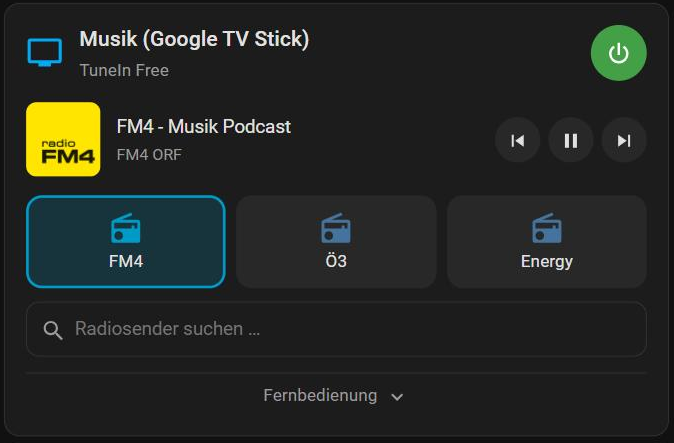

# Fernseher-Karte

Google TV / Android TV: Ein/Aus, laufende App, Titel, App-Tasten und Fernbedienung



## Installation

### Über den Marketplace (Home Assistant 2026.11 und neuer)

1. **Einstellungen** → **Marketplace** → **Aus Link hinzufügen**.
2. Die Adresse dieses Repositorys eintragen, Kategorie **Dashboard**.
3. **Fernseher-Karte** installieren. Die Ressource wird dabei automatisch eingetragen.

### Über HACS (ältere Versionen)

**HACS** → ⋮ → **Benutzerdefinierte Repositories** → Adresse dieses Repositorys, Typ **Dashboard** → installieren.

### Manuell

`fernseher-karte.js` nach `/config/www/` kopieren und unter **Einstellungen** → **Dashboards** → ⋮ → **Ressourcen**
als JavaScript-Modul `/local/fernseher-karte.js` eintragen.

## Verwendung

```yaml
type: custom:fernseher-karte
```

## Konfiguration

```
Fernseher-Karte: Google TV / Android TV in einer Karte (Ein/Aus, laufende App, Titel mit Cover,
App-Tasten, aufklappbare Fernbedienung mit Steuerkreuz und Lautstaerke).

  type: custom:fernseher-karte
  entity: media_player.google_tv_sofa        # Android-TV-Remote (Ein/Aus, Apps starten)
  remote: remote.google_tv_sofa              # optional, fuer Tasten und laufende App
  cast: media_player.wohnraum                # optional, Chromecast fuer Titel/Cover/Play
  name: Fernseher                            # optional
  apps:                                      # optional, Tasten: app = Link (bevorzugt) oder Paketname,
    - { name: Prime Video, app: "https://app.primevideo.com", paket: com.amazon.amazonvideo.livingroom, icon: mdi:filmstrip }
                                             # paket: optional, um die laufende App zu markieren
  fernbedienung: true                        # optional, Fernbedienung zum Aufklappen
  lautstaerke: media_player.pioneer_av_receiver   # optional, Lautstaerke-Tasten steuern dieses Geraet direkt
  tv: media_player.lg_webos_tv_uj675v        # optional, Bildschirm: Ein/Aus und Eingaenge laufen dann ueber ihn
  wecken: media_player.google_tv_sofa        # optional, Geraet, das den Bildschirm per HDMI-CEC aufweckt;
                                             # ohne tv: Geraet, das den nicht erreichbaren Stick einschaltet (z.B. Receiver)
  einschalten: script.lg_tv_einschalten      # optional, Skript, das den Bildschirm direkt einschaltet (z.B. Wake-on-LAN), wird zuerst versucht
  webos: media_player.lg_webos_tv_uj675v     # optional, Fernbedienungstasten an einen LG webOS (statt remote)
  sender: [{ name: FM4, id: "media-source://radio_browser/..." }]   # optional, Radiosender (ueber cast)
  suche: true                                # optional, Sendersuche (Radio Browser, laender: [AT])
  receiver_quelle: Strm-box                  # optional, Eingang am Receiver (lautstaerke) fuer das Radio
  eingaenge:                                 # optional, Eingangs-Tasten am Bildschirm
    - { quelle: HDMI-4, name: Google TV, icon: mdi:google }
    - { quelle: HDMI-1, name: Sat, geraet: media_player.vu_uno_4k }   # geraet: wird beim Umschalten mit eingeschaltet
```

## Lizenz

MIT
